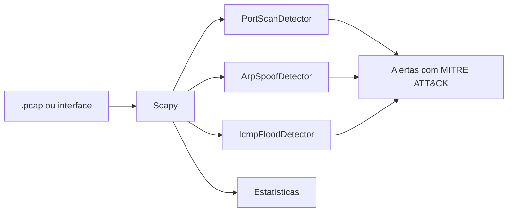

<p align="center"><sub>Network Sentinel</sub></p>

---

<p align="center">
  
</p>

<p align="center">
  Mini IDS com Scapy que detecta port scan, ARP spoofing e ICMP flood em pcap ou ao vivo
</p>

<p align="center">
  
  
  
  <a href="https://github.com/arthurlynow098/network-sentinel/actions/workflows/testes.yml"></a>
</p>

## Sobre o projeto

Depois de estudar Wireshark eu fiquei com uma pergunta na cabeça. Se eu consigo **ver** uma varredura de portas olhando os pacotes, dá para escrever um programa que **perceba sozinho**? É isso que um IDS como Snort ou Suricata faz.

O Network Sentinel é um IDS pequeno, feito com Scapy. Ele lê um arquivo `.pcap` (ou escuta a rede ao vivo) e aplica três regras de detecção. O projeto acompanha um `.pcap` de laboratório com tráfego normal misturado com três ataques, para dar para testar sem precisar atacar nada.

## Como funciona



## Tecnologias

<p>
  
  
  
</p>

## Executando o código

```bash
git clone https://github.com/arthurlynow098/network-sentinel.git
cd network-sentinel
pip install scapy

# analisa o pcap de laboratório
python -m sentinel --pcap exemplos/laboratorio.pcap

# gera o pcap de novo (os pacotes são montados em memória, nada vai para a rede)
python exemplos/gerar_pcap.py

# escuta ao vivo, precisa de admin e no Windows do Npcap instalado
sudo python -m sentinel --iface eth0
```

Use o modo ao vivo só na sua rede ou numa rede de laboratório. Capturar tráfego de outras pessoas sem autorização não é legal.

Testes

```bash
pip install -r requirements-dev.txt
python -m pytest -q
```

## Exemplo

```text
  lendo exemplos/laboratorio.pcap

  18:20:12 [alta] port scan de 192.168.0.66, SYN para 15 portas de 192.168.0.20 em 10s (T1046)
  18:20:20 [critica] ARP spoofing de de:ad:be:ef:00:66, 192.168.0.1 mudou de aa:bb:cc:00:00:01 para de:ad:be:ef:00:66 (T1557.002)
  18:20:25 [media] ICMP flood de 198.51.100.7, 50 echo requests em 1s (T1498)

  162 pacotes analisados
  protocolos  ICMP 80  TCP 60  UDP 20  ARP 2
  quem mais falou
    198.51.100.7      80
    192.168.0.20      40
    192.168.0.66      40

  3 alerta(s)
```

## Estudei por aqui

Segui essas aulas e materiais para entender e aplicar tudo que está aqui.

| Material | O que tirei dele |
|---|---|
| [TryHackMe, Wireshark The Basics](https://tryhackme.com/room/wiresharkthebasics) | Ler captura, filtros e reconhecer padrões de tráfego |
| [TryHackMe, What is Networking?](https://tryhackme.com/room/whatisnetworking) | Base de redes, ARP, IP e protocolos |
| [Documentação do Scapy](https://scapy.readthedocs.io/en/latest/usage.html) | Montar, ler e filtrar pacotes |
| [MITRE ATT&CK T1557.002, ARP Cache Poisoning](https://attack.mitre.org/techniques/T1557/002/) | Como o ataque funciona e como detectar |
| [MITRE ATT&CK T1046, Network Service Discovery](https://attack.mitre.org/techniques/T1046/) | O lado de quem defende de uma varredura |

## Licença

Distribuído sob a licença MIT. Veja o arquivo [LICENSE](LICENSE).

<p align="center"><sub>A gravura do banner é o falcão-peregrino de John Gould, de 1837, em domínio público no <a href="https://commons.wikimedia.org/wiki/File%3AThe_birds_of_Europe_%289401303060%29.jpg">Wikimedia Commons</a>.</sub></p>
