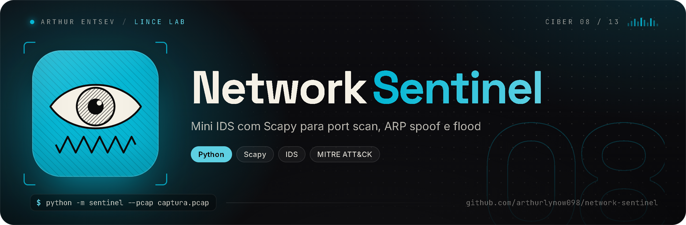
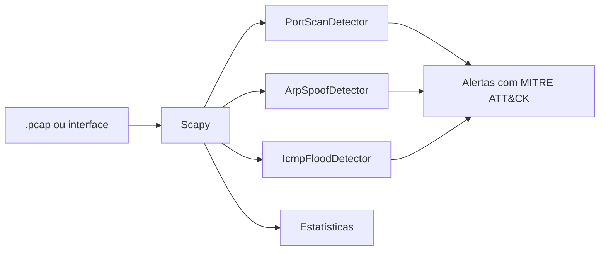

<a id="top"></a>

<p align="center"></p>

<p align="center">


<a href="https://github.com/arthurlynow098/network-sentinel/actions/workflows/testes.yml"></a>
</p>

<p align="center"><a href="#sobre">Sobre</a> &nbsp;&nbsp; <a href="#como-funciona">Como funciona</a> &nbsp;&nbsp; <a href="#rodando">Rodando</a> &nbsp;&nbsp; <a href="#aprendi">O que aprendi</a> &nbsp;&nbsp; <a href="#estudos">Estudos</a></p>

<a id="sobre"></a>

<p></p>

Depois de estudar Wireshark eu fiquei com uma pergunta na cabeça. Se eu consigo **ver** uma varredura de portas olhando os pacotes, dá para escrever um programa que **perceba sozinho**? É isso que um IDS como Snort ou Suricata faz.

O Network Sentinel é um IDS pequeno, feito com Scapy. Ele lê um arquivo `.pcap` (ou escuta a rede ao vivo) e aplica três regras de detecção. O projeto acompanha um `.pcap` de laboratório com tráfego normal misturado com três ataques, para dar para testar sem precisar atacar nada.

<a id="como-funciona"></a>

<p></p>



| Detector | Lógica | MITRE |
|---|---|---|
| **Port scan** | O mesmo IP manda SYN (sem ACK) para 15 portas diferentes de um alvo em 10 segundos | T1046 |
| **ARP spoofing** | Uma resposta ARP diz que um IP conhecido agora tem outro MAC. É assim que começa um man-in-the-middle na rede local | T1557.002 |
| **ICMP flood** | Mais de 50 pings do mesmo IP dentro de 1 segundo | T1498 |

Decisões que valem comentar

- **O tempo vem do pacote, não do relógio.** Por isso o mesmo código serve para captura ao vivo e para analisar um `.pcap` de dias atrás.
- **Janela deslizante.** Uma varredura lenta, de uma porta a cada minuto, não dispara. Isso é proposital e está documentado como limitação, porque é exatamente o que um atacante mais cuidadoso faria.
- **SYN-ACK não conta.** Só o primeiro passo do handshake indica quem está iniciando conexões, senão o servidor respondendo viraria "atacante".
- **Cada detector é uma classe com `feed`.** Para criar uma regra nova basta escrever outra classe e colocar na lista.

<a id="rodando"></a>

<p></p>

```bash
git clone https://github.com/arthurlynow098/network-sentinel.git
cd network-sentinel
pip install scapy

# analisa o pcap de laboratório
python -m sentinel --pcap exemplos/laboratorio.pcap

# gera o pcap de novo (os pacotes são montados em memória, nada vai para a rede)
python exemplos/gerar_pcap.py

# escuta ao vivo, precisa de admin e no Windows do Npcap instalado
sudo python -m sentinel --iface eth0
```

Use o modo ao vivo só na sua rede ou numa rede de laboratório. Capturar tráfego de outras pessoas sem autorização não é legal.

Testes

```bash
pip install -r requirements-dev.txt
python -m pytest -q
```

<p></p>

```text
  lendo exemplos/laboratorio.pcap

  18:20:12 [alta] port scan de 192.168.0.66, SYN para 15 portas de 192.168.0.20 em 10s (T1046)
  18:20:20 [critica] ARP spoofing de de:ad:be:ef:00:66, 192.168.0.1 mudou de aa:bb:cc:00:00:01 para de:ad:be:ef:00:66 (T1557.002)
  18:20:25 [media] ICMP flood de 198.51.100.7, 50 echo requests em 1s (T1498)

  162 pacotes analisados
  protocolos  ICMP 80  TCP 60  UDP 20  ARP 2
  quem mais falou
    198.51.100.7      80
    192.168.0.20      40
    192.168.0.66      40

  3 alerta(s)
```

<a id="aprendi"></a>

<p></p>

- Como as camadas Ethernet, IP e TCP aparecem dentro de um pacote e como acessar cada uma no Scapy
- As flags TCP (SYN, ACK, RST) e o que cada combinação significa
- Por que o ARP é tão fácil de enganar e como isso vira man-in-the-middle
- Montar tráfego sintético para testar detecção sem depender de ataque real
- A diferença entre um IDS por assinatura e um por comportamento

Limitações e próximos passos

- [ ] Detectar varredura lenta guardando histórico mais longo
- [ ] Ler regras de um arquivo YAML em vez de deixar no código
- [ ] Exportar alertas no formato EVE JSON do Suricata para jogar num SIEM

<a id="estudos"></a>

<p></p>

Segui essas aulas e materiais para entender e aplicar tudo que está aqui.

| Material | O que tirei dele |
|---|---|
| [TryHackMe, Wireshark The Basics](https://tryhackme.com/room/wiresharkthebasics) | Ler captura, filtros e reconhecer padrões de tráfego |
| [TryHackMe, What is Networking?](https://tryhackme.com/room/whatisnetworking) | Base de redes, ARP, IP e protocolos |
| [Documentação do Scapy](https://scapy.readthedocs.io/en/latest/usage.html) | Montar, ler e filtrar pacotes |
| [MITRE ATT&CK T1557.002, ARP Cache Poisoning](https://attack.mitre.org/techniques/T1557/002/) | Como o ataque funciona e como detectar |
| [MITRE ATT&CK T1046, Network Service Discovery](https://attack.mitre.org/techniques/T1046/) | O lado de quem defende de uma varredura |

<p align="center"><sub>Parte do <a href="https://github.com/arthurlynow098">Lince Lab</a>, minha coleção de projetos de cibersegurança</sub></p>

<p align="center"><a href="#top">Voltar ao topo</a></p>
